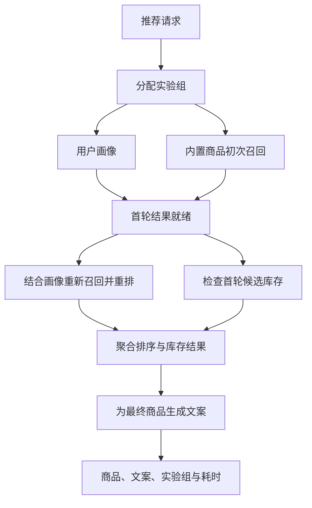
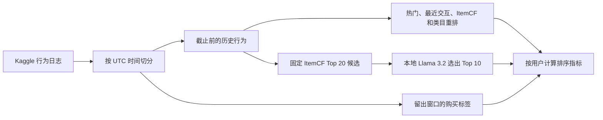

<div align="center">

# E-commerce Multi-Agent System

### 电商多 Agent 推荐与验证系统

**用户行为 → 商品推荐与营销文案 ｜ 历史日志 → 排序评估与链路验证**

[项目概览](#项目概览) · [推荐服务](#模块一-电商多-agent-推荐) · [验证模块](#模块二-离线评估与集成验证) · [实测结果](#评测指标与实际结果) · [快速开始](#环境与快速开始) · [源码导航](#源码导航)

</div>

---

## 项目概览

项目围绕一个电商推荐请求展开。系统根据用户行为组织画像，召回并重排商品，检查库存，再为最终推荐生成营销文案。配套实验用真实购买记录比较排序方案，并通过接口测试观察这些 Agent 在缺货、模型异常和分组切换时的实际行为。

| 模块 | 可以做什么 | 核心技术 | 目录 |
| --- | --- | --- | --- |
| 电商多 Agent 推荐 | 运行推荐 API，查看推荐商品、营销文案、实验分组与耗时 | FastAPI · asyncio · LangGraph · Pydantic | [`demo/`](demo/) |
| 离线评估与集成验证 | 比较推荐基线和 LLM 重排，复现库存约束与 Agent 协作问题 | Kaggle / REES46 · SciPy · Ollama · pytest | [`validation/`](validation/) |

## 模块一 电商多 Agent 推荐

### 推荐流程

以下是 Supervisor 入口的一次请求。画像、商品推荐、库存与文案由四个 Agent 分工，商品推荐 Agent 负责召回和重排。



| Agent | 读入 | 产出 |
| --- | --- | --- |
| 用户画像 | 用户 ID、浏览与购买上下文 | 用户分群、偏好类目、价格区间 |
| 商品推荐 | 内置商品目录、用户画像、目标条数 | 候选商品和 LLM 重排结果 |
| 库存决策 | 首轮候选及商品库存 | 可用商品 ID、库存预警、建议限购 |
| 营销文案 | 用户分群、最终商品列表 | 对应商品的个性化文案 |

演示使用内置商品及模拟库存。Redis 特征存储、Milvus 向量召回和实时库存查询为设计中的接入点。 [架构设计](docs/architecture.md)

### 输入与输出

两个推荐入口接受同样的请求参数。以 Supervisor 入口为例，`context` 可以传入近期浏览、购买次数和金额等行为信息。

```json
{
  "user_id": "demo-user",
  "scene": "homepage",
  "num_items": 3,
  "context": {
    "recent_views": ["耳机", "笔记本"],
    "recent_purchases": ["充电器"],
    "view_count_7d": 12,
    "purchase_count_30d": 2,
    "avg_order_amount": 399.0
  }
}
```

| 字段 | 含义 |
| --- | --- |
| `products` | 最终返回的商品及价格、类别等属性 |
| `marketing_copies` | 按商品 ID 关联的营销文案 |
| `experiment_group` | 分配到的实验组标签 |
| `total_latency_ms` | 本次推荐耗时，单位为毫秒 |

Supervisor 响应还包含 `agent_results`，用于查看各阶段的状态和耗时。 [请求与响应模型](demo/models/schemas.py)

## 模块二 离线评估与集成验证

### 怎样评估推荐

使用 REES46 的 2019 年 10 月多品类电商行为日志，按用户固定采样得到 **2,034,719 条事件**。留出窗口内的购买记录去重后作为相关商品标签。最终测试用 **10 月 1–6 日**的历史记录排序，预测 **7–8 日**的购买，覆盖 **3,152 名有历史行为的买家**及 **4,120 个去重的用户–购买商品对**。另外 2,914 名没有训练期行为记录的买家未纳入比较。所有时间切分均为 UTC。 [Kaggle 数据集](https://www.kaggle.com/datasets/mkechinov/ecommerce-behavior-data-from-multi-category-store) · [数据清单](validation/results/marketplace-kaggle-oct-sample.json)



离线脚本独立训练 ItemCF。LLM 对照复用原商品 Agent 的重排提示词，从固定候选池返回前 10 件。集成测试走真实的 FastAPI 路由和 Agent 逻辑，在模型调用处注入可控响应，并使用模拟库存。 [离线评估脚本](validation/offline/evaluate.py) · [LLM 对照脚本](validation/llm/evaluate_llm.py) · [集成测试](validation/integration/test_integration.py)

## 评测指标与实际结果

### 购买预测与商品发现

Recall@10 衡量前 10 件找回了多少后来购买的商品。NDCG@10 给排位靠前的命中更高权重。Hit Rate@10 衡量至少找回一件的买家占比，Recall@100 用于观察更大的候选池。

| 方法 | Recall@10 | NDCG@10 | Hit Rate@10 | Recall@100 |
| --- | ---: | ---: | ---: | ---: |
| 热门推荐 | 14.93% | 0.0848 | 17.77% | 37.27% |
| 最近交互（热门补齐） | **44.38%** | **0.3323** | **49.24%** | **61.16%** |
| ItemCF | 20.24% | 0.1096 | 23.92% | 49.39% |
| ItemCF + 类目重排 | 20.23% | 0.1096 | 23.95% | 49.39% |

最近交互在短期购买预测中表现最好。在用户历史中未接触过的目录内商品上，ItemCF 的 NDCG@10 最高，为 **0.0930**。整体测试中，ItemCF 比热门推荐的 NDCG@10 高 **0.0248**，配对用户 Bootstrap 的 95% CI 为 **[0.0142, 0.0349]**。 [验证期指标](validation/results/marketplace-validation-metrics.json) · [测试期指标](validation/results/marketplace-test-metrics.json)

### 固定候选下的 LLM 重排

在同一测试窗口抽取 48 名买家。两组共用每人 20 件 ItemCF 候选，分别比较原始 ItemCF 前 10 件和本地 **Llama 3.2** 重排结果。

| 指标 | ItemCF | LLM 重排 | 增量的 95% CI |
| --- | ---: | ---: | ---: |
| Recall@10 | 15.83% | 18.19% | −6.95 至 +11.81 个百分点 |
| NDCG@10 | 0.0775 | 0.0881 | [−0.0362, +0.0521] |
| Hit Rate@10 | 18.75% | 22.92% | −6.25 至 +14.58 个百分点 |

三个区间均跨零，当前样本尚未显示稳定增益。48 次调用中有 7 次输出重复 ID、5 次输出候选外 ID。实验脚本将这 12 次结果回退到 ItemCF，实测重排延迟 P95 为 **5.33 秒**。 [LLM 汇总结果](validation/results/marketplace-test-llm-results.json)

### Agent 集成验证

Supervisor 和 LangGraph 的正常路径可运行。带真实商品样本的完整测试有 **19 项通过**，其中 **9 项**断言用于复现缺陷。 [集成用例与实测记录](validation/integration/README.md)

| 场景 | 实测行为 |
| --- | --- |
| 库存约束 | 全缺货回退仍返回零库存商品。重排再次召回时，未经库存检查的商品也可能进入结果。 |
| 结果与文案校验 | 重复推荐 ID、目录外文案商品 ID 和错误价格可进入响应。 |
| 超时与降级 | 外部模型抛出超时后会重试，Agent 的配置阈值尚未限制等待。 |
| A/B 分组 | `control` 和 `treatment_llm` 标签不同，实际执行了相同的重排策略。 |

## 环境与快速开始

### 启动推荐 API

使用 Python 3.13 验证过本地启动。原演示 Dockerfile 以 Python 3.12 为基础镜像。从仓库根目录运行：

```bash
python3.13 -m venv .venv
source .venv/bin/activate
python -m pip install -r demo/requirements.txt
cd demo
cp .env.example .env
```

在 `demo/.env` 填写 OpenAI 兼容服务的地址、模型和密钥，对应 `ECOM_LLM_BASE_URL`、`ECOM_LLM_MODEL` 和 `ECOM_LLM_API_KEY`。在 `demo/` 内启动服务：

```bash
python -m uvicorn main:app --host 127.0.0.1 --port 8000
```

通过 [Swagger UI](http://127.0.0.1:8000/docs) 查看接口，或在另一个终端发起请求。

```bash
curl -fsS http://127.0.0.1:8000/health
curl -fsS -X POST http://127.0.0.1:8000/api/v1/recommend \
  -H 'Content-Type: application/json' \
  -d '{"user_id":"demo-user","num_items":3}'
```

LangGraph 入口为 `POST /api/v1/recommend/graph`。`GET /api/v1/experiments` 返回实验配置，`GET /api/v1/metrics` 查看 Supervisor 入口的监控统计。

### 运行验证

从仓库根目录启动独立的测试环境。默认测试使用模型替身，17 项通过，另两项真实目录场景在提供本地 Kaggle 样本后运行。

```bash
python3.13 -m venv .venv-integration
.venv-integration/bin/python -m pip install -r validation/integration/requirements-lock.txt
PYTHONPATH=demo .venv-integration/bin/python -m pytest -q demo/tests validation/integration
```

日志下载、固定采样、离线排序、真实商品场景和本地 Ollama 重排的完整命令见 [验证复现指南](validation/README.md)。

## 当前进展

两个推荐入口、离线排序对比与本地重排实验均已有可复查的结果。进一步接入生产服务前，库存测试需要确保最终商品全部经过库存校验，全缺货时返回空列表。文案校验、超时边界和 A/B 策略分发也已有可复现的用例。 [集成测试记录](validation/integration/README.md)

## 源码导航

| 入口 | 内容 |
| --- | --- |
| [`demo/main.py`](demo/main.py) | FastAPI 入口及接口定义 |
| [Supervisor](demo/orchestrator/supervisor.py) · [LangGraph](demo/orchestrator/graph.py) | 两种编排方式 |
| [`demo/agents/`](demo/agents/) | 用户画像、商品推荐、库存决策与营销文案 |
| [`validation/README.md`](validation/README.md) | 真实数据、离线指标与集成测试复现命令 |
| [`validation/results/`](validation/results/) | 数据清单、汇总指标与模型运行记录 |
| [`docs/architecture.md`](docs/architecture.md) | 架构设计与生产化设想 |

## 来源与许可

`demo/` 源自 bcefghj 的 Multi-Agent 电商项目。上游 README 声明采用 MIT 许可证。 [上游 Python 实现](https://github.com/bcefghj/multi-agent-ecommerce-system/tree/faf0fd8309c550426f3b2cce057dd4566e209e09/python) · [上游许可证声明](https://github.com/bcefghj/multi-agent-ecommerce-system#-license)

README 的模块化组织与结果展示参考了 Zicheng-Xie 的项目。 [参考 README](https://github.com/Zicheng-Xie/E-commerce-Multimodal-Intelligent-Content-and-Retrieval-System#readme)
